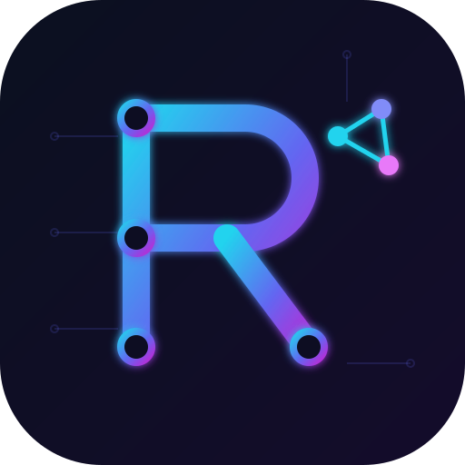

<p align="center">
  
</p>

<h1 align="center">Radon 1</h1>

<p align="center">
  Token-lean, maximum-reasoning work protocol for Claude Code,<br>
  with a verified, privacy-guarded swarm of free LLMs.
</p>

## Install (Claude Code plugin)

Inside Claude Code:

```
/plugin marketplace add noman-agri/Radon
/plugin install radon-1@radon
```

Or from a terminal:

```bash
claude plugin marketplace add noman-agri/Radon
claude plugin install radon-1@radon
```

Restart Claude Code after installing. The skill activates automatically on non-trivial work; type `/orch` for orchestrator mode.

## What it does

- **Lean protocol**: reasoning steps, hard token rules, and a quality floor (saving tokens never skips verification).
- **Knowledge primers**: short domain briefs (ML, data analysis, software) loaded before unfamiliar work.
- **`/orch` mode**: Claude plans and judges; free models extract from large files and give a second-opinion code review.
- **Anti-hallucination layers**: verbatim-quote verification, quote-anchored findings, multi-model swarm voting (>= 2 must agree), final verification by Claude, deterministic tests on top.
- **Data protection**: blocks sensitive files (`.env`, keys, credentials, raw data), redacts secrets / emails / IPs before sending, metadata-only audit log, `--private` mode (local Ollama only).

## Free models (optional, for `/orch`)

Run from the skill folder (`skills/radon-1`):

```bash
python scripts/set_key.py openrouter   # or: gemini, groq ...  (paste the key once)
python scripts/free_llm.py ping
```

Keys are stored in `~/.radon/secrets.env`, outside the plugin, and are never committed. Providers and links: `skills/radon-1/references/orchestrator.md`. Free tiers may log or train on prompts: use `--private` (local Ollama) for confidential code.

Requirements: Python 3.9+ (stdlib only). Tests: `python -m unittest discover -s skills/radon-1/tests`.

## License

Proprietary. You may install and use Radon 1 for your own work. Copying, modifying, redistributing, or publishing customized or renamed versions requires written permission. See [LICENSE](LICENSE).
