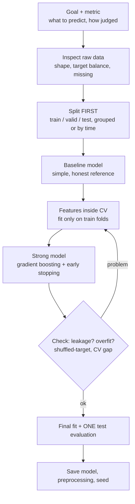

# Primer: Machine Learning (tabular / general)

**Goal & metric:** state the target, the unit of prediction, and the metric that matches the business cost (AUC for ranking, log-loss for calibrated probabilities, F1/recall for rare positives, RMSE/MAE for regression). Fix the metric before modelling.

**Standard pipeline**
1. Inspect raw data: shape, dtypes, target balance, missing %, duplicates, ID/time columns.
2. Split FIRST (stratified, grouped by entity, or time-based if data has time). Test set is touched once at the end.
3. Simple baseline (majority class / mean, then logistic or linear regression).
4. Strong tabular model: gradient boosting (LightGBM / XGBoost / CatBoost) with early stopping on a validation fold.
5. Feature engineering inside the CV loop only (`Pipeline` / per-fold fit).
6. Cross-validation + error analysis (worst segments, confusion matrix, residuals).
7. Final fit, one test evaluation, save model + exact preprocessing + seed.

**Top pitfalls (check every time)**
- Leakage: fitting scalers/imputers/encoders/target-encoding on all data; features computed from the future or from the target; same customer in train and test.
- Overfitting: CV-vs-train gap > a few points, tuning on the test set, too many tuning rounds on one fold.
- Class imbalance treated with accuracy; resampling done before the split.
- Train/inference mismatch: different preprocessing code paths or category levels.
- Random seeds and fold splits not fixed -> results not reproducible.

**Verification checks**
- Shuffled-target run should score ~chance (if not: leakage).
- Feature importance sanity: a single feature dominating suspiciously = leakage suspect.
- CV std across folds reported, not just the mean.

**Minimal tools:** pandas/polars, scikit-learn (Pipeline, StratifiedKFold/GroupKFold/TimeSeriesSplit), LightGBM, matplotlib.

**Standard flowchart** (adapt labels to the user's data and target)

